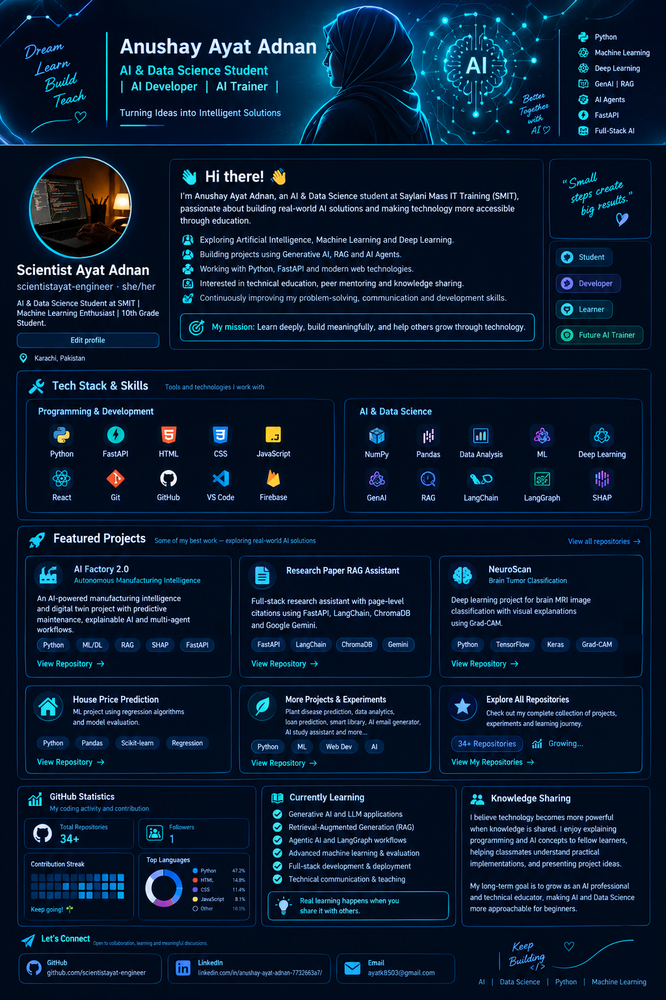

# 👋 Hi, I'm Anushay Ayat Adnan

  

<!-- ANIMATED INTRODUCTION -->

<h1 align="center">
  Hi there! 👋 I'm Anushay Ayat Adnan
</h1>

  

  Turning curiosity into code and ideas into intelligent solutions.

---

  <b>AI & Data Science Student | AI Developer | Aspiring AI Trainer</b>

  Building intelligent solutions • Exploring AI • Sharing knowledge

  
  
  

---

## 💫 About Me

I'm an **AI & Data Science student at Saylani Mass IT Training (SMIT)**, passionate about building practical solutions with Artificial Intelligence and modern software technologies.

My journey is about more than writing code. I want to understand how intelligent systems work, build useful applications, and make technical concepts easier for others to learn.

- 🤖 Exploring Artificial Intelligence, Machine Learning, and Deep Learning.
- 🧠 Developing projects involving Generative AI, RAG, and AI agents.
- 🐍 Working with Python, data analysis, machine learning, and APIs.
- 🌐 Building AI-powered applications using FastAPI and web technologies.
- 👩‍🏫 Interested in technical education, peer mentoring, and knowledge sharing.
- 🚀 Improving my problem-solving, communication, and software development skills.

### 🎯 My Mission

> Learn deeply. Build meaningfully. Share knowledge. Help others grow through technology.

---

## 🛠️ Tech Stack

### Programming & Web Development

  

### AI & Data Science

  
  
  
  
  
  
  
  
  
  

**Areas of interest:**

- Data analysis and exploratory data analysis
- Machine learning and model evaluation
- Deep learning and computer vision
- Generative AI and large language models
- Retrieval-Augmented Generation (RAG)
- AI agents and agentic workflows
- REST APIs and full-stack AI applications
- Model explainability and MLOps

---

## 🚀 Featured Projects

### 🏭 1. AI Factory 2.0

**Autonomous Manufacturing Intelligence & Digital Twin**

An AI-focused manufacturing project exploring predictive maintenance, production intelligence, explainable AI, and multi-agent workflows.

**Tech:** Python, FastAPI, Machine Learning, RAG, SHAP, MLflow

[**Explore AI Factory 2.0 →**](https://github.com/scientistayat-engineer/AI-Factory-Hackathon)

### 📚 2. Research Paper RAG Assistant

A full-stack research assistant designed to answer questions about uploaded research papers with page-level citations.

**Tech:** FastAPI, LangChain, ChromaDB, Google Gemini

[**Explore Research Paper RAG Assistant →**](https://github.com/scientistayat-engineer/research-paper-rag-assistant)

### 🧠 3. NeuroScan — Brain Tumor Classification

A deep learning project focused on brain MRI image classification and visual explanations using Grad-CAM.

**Tech:** Python, TensorFlow/Keras, MobileNetV2, Grad-CAM

[**Explore NeuroScan →**](https://github.com/scientistayat-engineer/NeuroScan-AI-Brain-Tumor-Classification-by-Ayat)

### 🏡 4. House Price Prediction

A machine learning project exploring house price prediction using regression algorithms and model evaluation.

**Tech:** Python, Pandas, Scikit-learn, Regression

[**Explore House Price Prediction →**](https://github.com/scientistayat-engineer/House-Price-Prediction---Ayat-Assignment)

### 🌱 More Projects

My other areas of project exploration include:

- AI-powered email generation
- Retrieval-Augmented Generation applications
- Data analytics and customer segmentation
- Loan prediction and classification
- Smart Library Management Systems
- AI study assistants
- Cyber-threat intelligence

  

---

## 📊 GitHub Statistics & Activity

  

  

  

### 📈 Contribution Activity

  

  

---

## 🌱 Currently Learning & Exploring

- Generative AI and LLM-powered applications
- Retrieval-Augmented Generation (RAG)
- Agentic AI and LangGraph workflows
- Advanced machine learning and model evaluation
- Full-stack AI development
- Deployment, integration, and production workflows
- Technical communication and teaching

---

## 👩‍🏫 AI Development & Knowledge Sharing

I believe that technology becomes more powerful when knowledge is shared.

I enjoy helping fellow learners understand programming concepts, explaining practical implementations, and exploring ways to make Artificial Intelligence more accessible to beginners.

My long-term direction combines two interests:

**AI Developer:** Building useful, reliable, and intelligent applications.

**AI Trainer:** Helping learners understand AI concepts through clear explanations and practical examples.

---

## 🤝 Let's Connect

I'm interested in connecting with developers, fellow students, mentors, educators, and people building meaningful technology.

  
  

---

  <i>"Every expert was once a beginner. Keep learning, keep building, and keep growing."</i>

  ⭐ Thanks for visiting my profile!

  AI • Data Science • Python • Machine Learning • Generative AI • RAG • AI Agents

